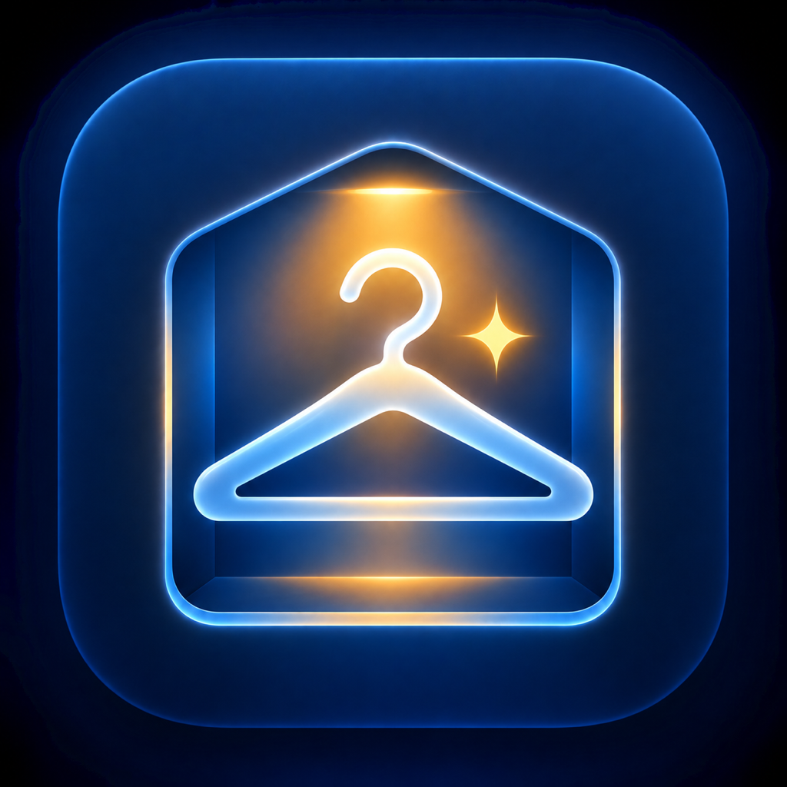

# Styleboard

  

Styleboard is your private wardrobe and outfit planner for iPhone. It analyzes clothing photos, keeps an editable wardrobe, and suggests outfits using only the clothes you own.

Everything runs on the iPhone. There is no account, subscription, server, Docker setup, API key, or monthly hosting bill.

## Before you start

You need all four of these:

- A **Mac**
- An **iPhone with iOS 17 or newer**
- A free **Apple ID**
- **Xcode**, which is free from the Mac App Store

> You cannot install this project directly from an iPhone or from the GitHub website. Apple requires Xcode on a Mac for this type of test installation.

## Install Styleboard on your iPhone

Follow these steps in order. You do not need Terminal, Docker, or programming knowledge.

### 1. Install Xcode

1. Open the **App Store** on your Mac.
2. Search for **Xcode**.
3. Click **Get** or **Install**.
4. Open Xcode once the installation finishes.
5. Accept any license or additional-component prompts from Apple.

### 2. Download Styleboard

1. On your Mac, click **[Download Styleboard](https://github.com/PandyaAbhi/Styleboard-iOS/raw/refs/heads/main/Styleboard-iOS.zip)**.
2. If your browser asks whether to download the file, click **Allow** or **Download**.
3. Open your Mac's **Downloads** folder.
4. Double-click **Styleboard-iOS.zip** to unzip it.
5. Open the new **Styleboard-iOS** folder, then open the `ios` folder.
6. Double-click **ClosetAI.xcodeproj**. It will open in Xcode.

### 3. Add your Apple ID to Xcode

1. In the Mac menu bar, click **Xcode → Settings**.
2. Click **Accounts**.
3. Click the **+** button.
4. Choose **Apple Account** and sign in with your Apple ID.
5. Close the Settings window.

### 4. Set up signing

1. In Xcode's left sidebar, click the blue **ClosetAI** project icon at the very top.
2. Under **TARGETS**, click **ClosetAI**.
3. Open the **Signing & Capabilities** tab.
4. Check **Automatically manage signing**.
5. For **Team**, choose your name followed by **Personal Team**.
6. Change **Bundle Identifier** to something unique. Use this format:

   `com.yourname.styleboard`

   For example, someone named Sam Lee could use `com.samlee.styleboard`.

If the bundle identifier is already taken, add a few numbers to the end.

### 5. Connect your iPhone

1. Connect your iPhone to the Mac with a cable.
2. Unlock the iPhone.
3. If the iPhone asks whether to trust the computer, tap **Trust** and enter your passcode.
4. At the top of Xcode, click the device selector next to **ClosetAI**.
5. Choose your iPhone.

Xcode may ask you to enable **Developer Mode** on the iPhone. Follow the instructions Xcode displays. The iPhone may restart once.

### 6. Install and open the app

1. Keep the iPhone unlocked.
2. Click the triangular **Run ▶** button near the top-left corner of Xcode.
3. Wait while Xcode builds and installs Styleboard.
4. Styleboard should open automatically on the iPhone.

The first build can take a few minutes. Future builds are usually faster.

## Add your first garment

1. Open the **Wardrobe** tab.
2. Tap the **+** button.
3. Choose **Take Photo** or **Choose from Photo Library**.
4. Allow camera or photo access when iOS asks.
5. Styleboard analyzes the garment on the iPhone.
6. Tap the garment afterward to review or correct its name, category, color, material, and other details.

For the best results, photograph one garment at a time against a plain background.

## Generate an outfit

Add at least:

- One top
- One bottom
- One pair of shoes

You can also use one dress or other one-piece item plus shoes.

Then:

1. Open the **Stylist** tab.
2. Choose the occasion, vibe, season, and optional temperature.
3. Tap **Generate looks**.
4. Like, dislike, or save outfits. Styleboard uses that feedback to improve its local style profile.

## Your privacy

- Garment analysis happens on the iPhone.
- Photos remain in Styleboard's private app storage.
- Wardrobe details, saved outfits, feedback, and style preferences use SwiftData on the device.
- There is no login and no shared database.
- Each person who installs Styleboard gets a separate private wardrobe.
- Deleting the app deletes its local Styleboard data.

## Common problems

### “Bundle identifier is already in use”

Return to **Signing & Capabilities** and make the bundle identifier more unique, such as `com.yourname.styleboard2026`.

### Xcode cannot find the iPhone

Unlock the iPhone, reconnect the cable, tap **Trust** if asked, and wait about a minute. Then open Xcode's device selector again.

### Xcode says the iPhone is locked

Unlock the iPhone and press **Run ▶** again.

### Developer Mode is required

Follow Xcode's prompt. On the iPhone, Developer Mode is normally under **Settings → Privacy & Security → Developer Mode**. The phone will ask to restart.

### The app is not trusted

Follow the exact trust instructions shown by Xcode or iOS. Depending on the iOS version, the setting may appear under **Settings → General → VPN & Device Management**.

### “Could not connect to the server”

This version does not use a server. Make sure you downloaded the latest repository version and rebuild the app in Xcode.

### Camera does not open

Open **iPhone Settings → Privacy & Security → Camera** and allow Styleboard to use the camera.

### The app stops opening after some time

Apps installed with a free Personal Team may need to be signed again periodically. Reconnect the iPhone to the Mac, open the project in Xcode, and press **Run ▶** again.

### Outfit generation says more clothes are needed

Make sure the wardrobe includes an available top, bottom, and shoes. Items marked unavailable or in the laundry are not used.

## Updating to a newer version

The easiest beginner method is:

1. Download the newest ZIP from GitHub.
2. Unzip it.
3. Open its `ios/ClosetAI.xcodeproj` file.
4. Select your team and bundle identifier again if Xcode asks.
5. Connect the iPhone and press **Run ▶**.

Using the same bundle identifier normally replaces the old build while keeping its on-device data. Keep a backup of important photos because this is still a prototype.

## What is inside the project

- **SwiftUI** for the iPhone interface
- **Apple Vision and Core Image** for on-device garment analysis
- **SwiftData** for wardrobe, outfit, feedback, and profile records
- A local Swift outfit engine for validation, ranking, explanations, and recent-outfit avoidance

There are no paid services or external runtime dependencies.
